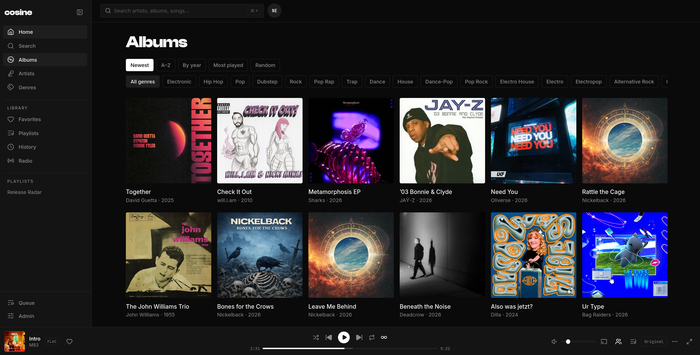

<p align="center">
  
</p>

<h1 align="center">cosine desktop</h1>

A lightweight Linux desktop client for [cosine](https://github.com/cosineaudio/cosine).

- Your existing web player, with the same design and features.
- Linux media keys and desktop playback controls through MPRIS.
- Saved server connection, login session, and window size.
- One running instance, with no background tray process.

Built with Rust, Tauri 2, and the system WebKitGTK engine.

<a href="assets/screenshots/albums.png"></a>

<sub>The player interface from the main cosine repository. The desktop client loads this same web app.</sub>

## Install from source

Requires a running [cosine server](https://github.com/cosineaudio/cosine#install-with-docker-compose),
Rust, Node.js 22 or later with npm, and the
[Linux build dependencies](docs/development.md#linux-dependencies).

```bash
git clone https://github.com/cosineaudio/cosine-desktop.git
cd cosine-desktop
npm ci
npm run build:binary
./scripts/install-local.sh
```

Open **cosine** from your application menu, or run:

```bash
~/.local/bin/cosine-desktop
```

The installer adds the app, launcher, and icons under `~/.local`. Set `PREFIX`
to choose another location. It does not need root or install system dependencies.

## Connect to your server

Enter the address you use in your browser, such as `https://music.example.com`
or `http://localhost:8080`. Use the server origin without a page path such as
`/albums`. Sign in on the normal cosine login screen.

If your server enables OIDC, use its configured public URL and choose
**Sign in with…**. The redirect and callback stay in the app on the real server
origin; no separate desktop OIDC client is required. Identity providers that
block embedded browsers may require a different sign-in flow, which is not
currently implemented.

Change servers using **cosine → Server connection…** (`Ctrl+,`). Each server
origin has a separate WebKit profile for cookies, cache, and preferences.

The client needs a reachable server to load and play your library. The web UI
comes from that server, so server updates also update the desktop interface.
It does not include a local music server or offline library.

## Desktop controls

| Action | Shortcut |
| --- | --- |
| Server connection | `Ctrl+,` |
| Reload | `Ctrl+R` |
| Fullscreen | `F11` |
| Zoom in / out | `Ctrl++` / `Ctrl+-` |
| Actual size | `Ctrl+0` |
| Quit | `Ctrl+Q` |

The web player's shortcuts, including `Space` to play or pause, still work.
Linux media controls expose title, artist, album, playback state, and position.
Artwork is currently shown in the player only. MPRIS requires a user D-Bus
session and WebKit MediaSession support.

Closing the player quits the app and stops playback. Launching it again while
it is already running focuses the existing window.
Find the installed version and project link under **cosine → About cosine**.

## Development

```bash
npm ci
npm run dev
```

No checkout or build of the server repository is needed. Connect to any compatible
running cosine server. The bundled connection screen lives in `ui/`; the Rust
desktop code lives in `src-tauri/`.

See [development](docs/development.md) for dependencies, checks, icon generation,
and Linux packages. See [architecture](docs/architecture.md) for the connection
lifecycle, storage, permissions, and performance approach.

## Contributing

[Open an issue](https://github.com/cosineaudio/cosine-desktop/issues) for bugs or
feature requests. Include the app version, Linux distribution, desktop session
(Wayland or X11), and WebKitGTK version. Remove credentials and private server
details from logs. Report shared player or server issues in
[cosine](https://github.com/cosineaudio/cosine/issues).

Keep changes focused and preserve the main app's design. Desktop-specific
screens use the same colors, fonts, logo, and control styles as the web app.

## License

[GNU Affero General Public License v3.0 only](LICENSE) (`AGPL-3.0-only`), matching
cosine. Third-party components retain their own licenses; see
[THIRD_PARTY_NOTICES.md](THIRD_PARTY_NOTICES.md).
